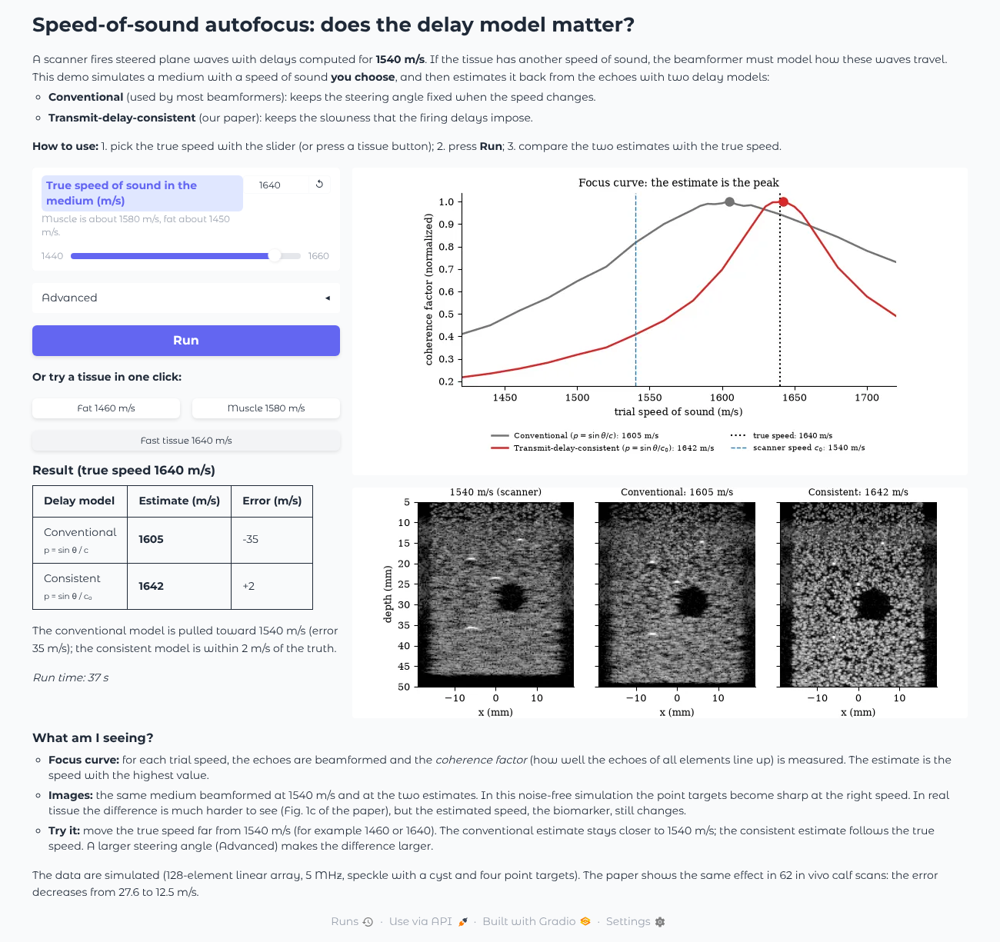

# Speed-of-sound autofocus with a differentiable plane-wave beamformer

Code for our paper on plane-wave speed-of-sound autofocus (S. Dehury, M. R. Panicker; submitted to
IEEE ISBI 2027).

[](https://colab.research.google.com/github/sdehury34/sos-autofocus/blob/main/demo/demo.ipynb)

Scanners fire steered plane waves with delays computed for $c_0$ = 1540 m/s, so the slowness of each
wave is $\sin\theta/c_0$. Common beamformers use $\sin\theta/c$ instead. On 62 in vivo calf
acquisitions (OpenH-RF), using the consistent slowness decreases the autofocus error from 27.6 to
12.5 m/s.

## Demo (no download)

Interactive app in the browser: pick a speed of sound, press **Run**, compare the two models.

```bash
pip install -r cubdl_sos/requirements.txt gradio
python demo/app.py
```



Or the same comparison as a script (`python demo/demo.py`) or in Colab (badge above).

The demo simulates media with known speeds: the conventional estimates are pulled toward 1540 m/s,
the consistent model finds the true speed.

## Contents

| Path | Content |
|---|---|
| `demo/` | Interactive app, demo script and Colab notebook |
| `cubdl_sos/` | Beamformer (JAX), loaders, estimation, simulator, data download, Dockerfiles ([guide](cubdl_sos/README.md)) |
| `figures/` | Scripts for Table 1 and Figs. 1-3 |
| `data/openh_rf/results_*` | Calf results used in the paper |

`python figures/make_figures.py` rebuilds Table 1 and Fig. 2 from the included results.

## Data

**Calf (OpenH-RF, CC-BY-4.0).** Accept the conditions on
[Hugging Face](https://huggingface.co/datasets/nvidia/OpenH-RF), make a read token, then:

```bash
export HF_TOKEN=hf_...
python cubdl_sos/download_waterloo_calf.py --out data/openh_rf/waterloo_calf   # 62 files, 28.6 GB
```

<details><summary>Re-run the calf analysis (about 2-3 h per run on a GPU) and Fig. 1</summary>

```bash
D=data/openh_rf/waterloo_calf; R=data/openh_rf; P="python cubdl_sos/run_sos_comparison.py --data $D"
$P --out $R/results_waterloo_30_60mm/results.csv --zmin 0.03 --zmax 0.06 --slowness angle
$P --out $R/results_waterloo_5_80mm/results.csv --zmin 0.005 --zmax 0.08 --slowness angle
$P --out $R/results_layers_30_60mm/results.csv --zmin 0.03 --zmax 0.06 --slowness delays --layers --layer-free-h --layer-grid
$P --out $R/results_layers_5_80mm/results.csv --zmin 0.005 --zmax 0.08 --slowness delays --layers --layer-free-h --layer-grid
python figures/make_fig_method.py
```
</details>

**CUBDL.** Request access on IEEE DataPort (DOI [10.21227/f0hn-8f92](https://doi.org/10.21227/f0hn-8f92))
and follow `cubdl_sos/README.md`. Do not redistribute the data.

## License and citation

Code: MIT. When you use the data, cite OpenH-RF (Stevens et al., arXiv:2610.13616), Xiao et al.
(UMB 2025; TUFFC 2024) and CUBDL (Hyun et al., TUFFC 2021).
