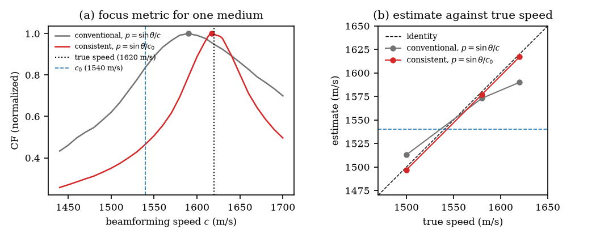

# Speed-of-sound autofocus with a differentiable plane-wave beamformer

Code for our paper on plane-wave speed-of-sound autofocus (S. Dehury, M. R. Panicker; submitted to
IEEE ISBI 2027).

[](https://colab.research.google.com/github/sdehury34/sos-autofocus/blob/main/demo/demo.ipynb)

Steered plane waves are fired with delays that a scanner computes for an assumed speed
$c_0$ = 1540 m/s, so the horizontal slowness of each wave is $\sin\theta/c_0$. Common
delay-and-sum codes use $\sin\theta/c$ with the estimated speed $c$ instead. This repository measures
the effect of that choice on global speed-of-sound (SoS) autofocus: on 62 in vivo calf acquisitions
(OpenH-RF), the consistent slowness and a depth window in the muscle decrease the mean absolute error
against through-transmission measurements from 27.6 to 12.5 m/s.

The data are not in this repository. The calf data are downloaded with a script (section 4); the
CUBDL data must be requested from their source (section 5).

## 1. Contents

| Path | Content |
|---|---|
| `demo/` | Demo on simulated data (no download): `demo.py` and the Colab notebook `demo.ipynb` |
| `cubdl_sos/` | The tool: differentiable plane-wave beamformer in JAX (`das.py`), loaders for CUBDL and OpenH-RF files (`cubdl_io.py`), estimation (`run_sos_comparison.py`), simulator (`make_synthetic.py`), calf download (`download_waterloo_calf.py`), Dockerfiles. Own guide: `cubdl_sos/README.md` |
| `figures/` | Scripts that make the table, the numbers and the figures of the paper |
| `data/openh_rf/results_*` | Calf results of the four runs in the paper (`results.csv` and the focus-metric curves in `curves/`) |
| `data/openh_rf/waterloo_calf/` | Empty; the calf files go here |

| Paper item | Script | Needs |
|---|---|---|
| Table 1, calf numbers in the text | `figures/make_figures.py` → `table_main.tex`, `numbers.txt` | `data/openh_rf/results_*` (included) |
| Fig. 2 (scatter plots) | `figures/make_figures.py` → `fig_scatter.pdf` | `data/openh_rf/results_*` (included) |
| Fig. 1 (delay model, CF curve, B-mode images) | `figures/make_fig_method.py` → `fig_method.pdf` | results + one calf file (p32, left) |
| Fig. 3 (CUBDL wire targets) | `figures/make_fig_cubdl.py` → `fig_cubdl.pdf`, `cubdl_wires.*` | CUBDL data and a CUBDL run |
| Calf results (`data/openh_rf/results_*`) | `cubdl_sos/run_sos_comparison.py` | the 62 calf files |
| Simulation (Sec. 3.1) | `cubdl_sos/make_synthetic.py --layer-h ... --c1 ...`, then `run_sos_comparison.py --layers` | nothing |

## 2. Quick start: the demo

```bash
pip install -r cubdl_sos/requirements.txt
python demo/demo.py
```

The demo simulates three media with known speeds (1500, 1580 and 1620 m/s) and estimates each speed
with both delay models. The conventional estimates are pulled toward 1540 m/s; the consistent model
finds the true speed within 3 m/s. It takes about 3-5 minutes on a laptop CPU and writes `demo/out/demo.png`. Or
open the notebook in Colab with the badge above.



## 3. Installation

Python 3.11 with the packages in `cubdl_sos/requirements.txt` (CPU). For an NVIDIA GPU, replace
`jax[cpu]` with `jax[cuda12]`.

Or with Docker (from `cubdl_sos/`):

```bash
docker build -t cubdl-sos .                          # CPU
docker build -f Dockerfile.gpu -t cubdl-sos-gpu .    # NVIDIA GPU (needs --gpus all)
```

In the commands below, `docker run --rm -v "$PWD:/w" -w /w --entrypoint python cubdl-sos` can replace
`python`. In Windows PowerShell 5.1, use `"${PWD}:/w"` and separate commands with `;`, not `&&`.

Table 1, the numbers and Fig. 2 need only the included results (a few seconds):

```bash
python figures/make_figures.py
```

## 4. Calf data (OpenH-RF, Waterloo subset)

The dataset is gated on Hugging Face. Once: log in, open
<https://huggingface.co/datasets/nvidia/OpenH-RF>, accept the conditions, and make a read token
(Settings → Access Tokens). Then (62 files, 28.6 GB; the download resumes after a stop):

```bash
export HF_TOKEN=hf_...                     # PowerShell: $env:HF_TOKEN = "hf_..."
python cubdl_sos/download_waterloo_calf.py --out data/openh_rf/waterloo_calf
```

The script selects one acquisition per participant and leg (lateral calf, longitudinal, relaxed,
minimal pressure). For Fig. 1 only, the file
`Acq_p32_Calf_left_calf_lateral_longitudinal_relaxed_minimal.hdf5` is enough:

```bash
python figures/make_fig_method.py
```

To run the calf analysis again (about 2-3 h per run on a GPU; it skips files that are already in the
output, so it resumes after a stop; depths in metres):

```bash
D=data/openh_rf/waterloo_calf; R=data/openh_rf
python cubdl_sos/run_sos_comparison.py --data $D --out $R/results_waterloo_30_60mm/results.csv --zmin 0.03 --zmax 0.06 --slowness angle
python cubdl_sos/run_sos_comparison.py --data $D --out $R/results_waterloo_5_80mm/results.csv --zmin 0.005 --zmax 0.08 --slowness angle
python cubdl_sos/run_sos_comparison.py --data $D --out $R/results_layers_30_60mm/results.csv --zmin 0.03 --zmax 0.06 --slowness delays --layers --layer-free-h --layer-grid
python cubdl_sos/run_sos_comparison.py --data $D --out $R/results_layers_5_80mm/results.csv --zmin 0.005 --zmax 0.08 --slowness delays --layers --layer-free-h --layer-grid
```

A run writes into an existing `results.csv`; to keep the included results, write to new folders and
change the folder names at the top of `figures/make_figures.py` and `figures/make_fig_method.py`.

## 5. CUBDL data

The CUBDL data are released under the CUBDL Data Release Agreement. Request access on IEEE DataPort
("Challenge on Ultrasound Beamforming with Deep Learning (CUBDL) Datasets", DOI
[10.21227/f0hn-8f92](https://doi.org/10.21227/f0hn-8f92)) and put the plane-wave `.hdf5` files in a
folder of your own. The procedure (installation test, beamformer check, run, summary) is in
`cubdl_sos/README.md`; the paper uses `--slowness delays`. The summary needs the CUBDL reference
speeds in `cubdl_sos/results/reference_sos.csv` (see that guide). Then:

```bash
python figures/make_fig_cubdl.py --data /path/to/cubdl --results cubdl_sos/results/results.csv --pick max
```

## 6. Data licenses and citation

* **OpenH-RF** (calf data): CC-BY-4.0. Cite Stevens et al., "OpenH-RF: A Large-Scale Ultrasound Raw
  Channel Dataset Initiative", arXiv:2610.13616, and the Waterloo study: Xiao et al., *Ultrasound Med.
  Biol.* 51(11), 2025, and Xiao et al., *IEEE TUFFC* 71(6), 2024. The results in `data/openh_rf/` are
  derived from these data (first frame, mean removal, band-pass filter).
* **CUBDL**: do not redistribute the data. Cite Hyun et al., *IEEE TUFFC* 68(12), 2021, and the dataset
  DOI above.
* **This code**: MIT license (`LICENSE`). If you use it, please cite the paper (reference to follow).
